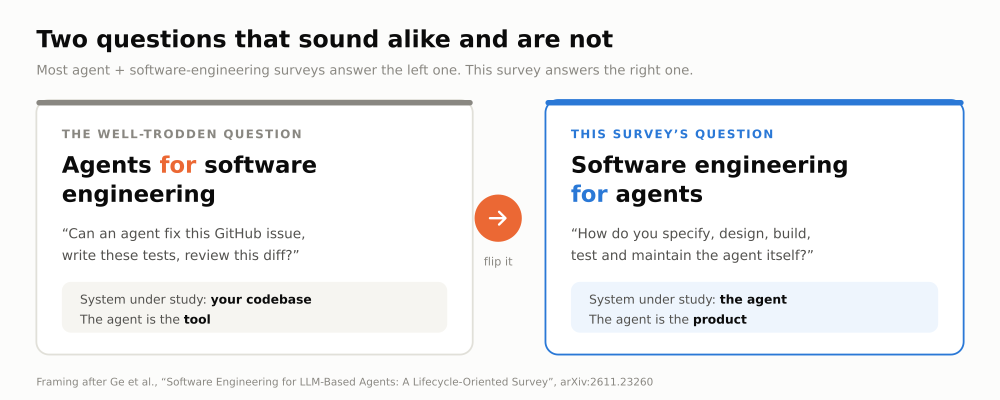
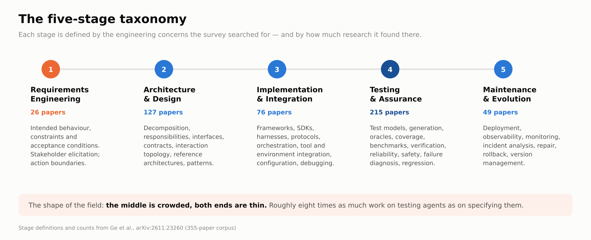
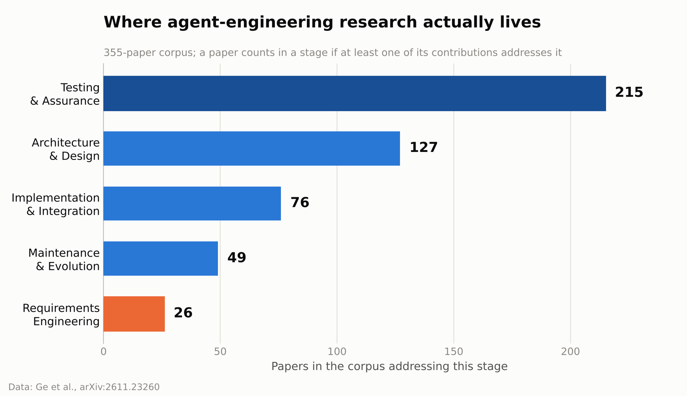
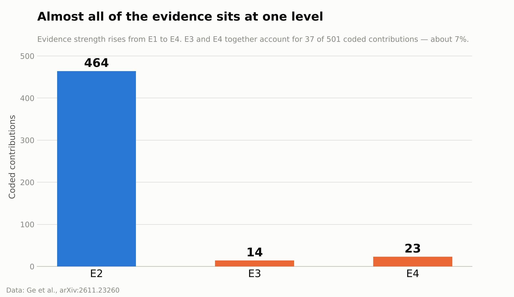
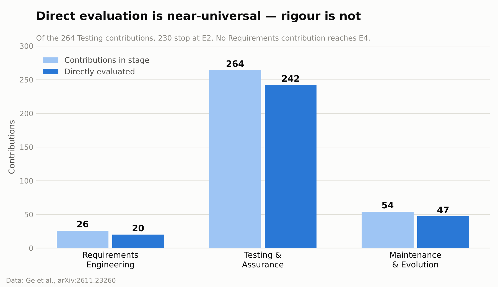
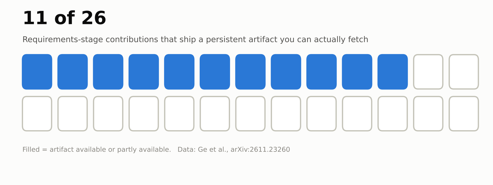

# We Spent Two Years Teaching Agents to Build Software. Nobody Taught Us to Build Agents.

### A 355-paper survey quietly inverts the question everyone has been asking — and the answer is less flattering than the leaderboards suggest.

---

*A short story on* **Software Engineering for LLM-Based Agents: A Lifecycle-Oriented Survey** *(Ge, Feng, Sun, Shi, Chen, Fang, Zhao, Chen, Liu & Jin — arXiv:2611.23260, October 2026), with supporting material from recent surveys on agent evaluation, harness design, and agent memory.*

---

## The sentence that reframes everything

There is a genre of paper that has become almost a monthly ritual: *LLM Agents for Software Engineering.* You know the shape of it. Agents localize bugs. Agents write patches. Agents generate tests. There is a SWE-bench number near the end, and it is higher than last month's.

Ge et al. do something different, and they announce it in a single clause buried in the introduction. They treat the agent system itself as the software under development.

Read that again, because it is the whole paper.

Every survey in the genre above asks *what can agents do to our software?* This one asks *what does it take to build the agent?* — where "the agent" is not a research artifact or a benchmark entry but a system that has stakeholders, interfaces, failure modes, an on-call rotation, and a version number that someone is going to bump on a Tuesday afternoon.

It sounds like a small pivot. It is not. It changes what counts as a result.

---

## Why the question got urgent

The authors' framing of the problem is worth sitting with, because it describes most agent teams I have watched from the inside.

Public engineering guidance for agents, they note, tends to follow a recognizable loop: start from a target task, pick a workflow or an autonomous design, then tune prompts, tools, and execution strategy against task outcomes, latency, and cost. That loop is genuinely good at producing a demo. It is also the entire methodology at a surprising number of companies.

What the loop does not cover is everything that becomes mandatory the moment an agent is *delivered as software*: stakeholder requirements, action boundaries, quality checks, maintenance. And three properties make that gap unusually painful:

**Execution varies run to run.** The same input does not reliably produce the same trajectory. Your test suite is now sampling from a distribution, not checking a function.

**Failures straddle a boundary.** When an agent does the wrong thing, the cause may be the model's decision or the tool it called. Classical debugging assumes you can localize a fault to code. Here the fault may be in a judgment.

**Previously accepted behavior is fragile.** Change a prompt, swap a model version, or let an upstream tool alter its interface, and things that passed yesterday can fail today — with no diff in your repository to blame.

That third property is, I think, the one the industry has least internalized. We have a mature mental model for "the dependency updated and broke us." We have almost none for "the dependency is a frontier model and its disposition shifted."

---

## The taxonomy: five stages, borrowed deliberately

The organizing move is unglamorous and exactly right. Rather than invent a novel taxonomy of agent concerns, the authors map the literature onto the software lifecycle every engineer already knows — requirements engineering (RE), architecture and design (A&D), implementation and integration (I&I), testing and assurance (T&A), and maintenance and evolution (M&E) — and ask one research question per stage.

A paper lands in a stage when at least one of its engineering contributions addresses that stage, so papers can and do span several. The search strategy is the clearest statement of what each stage *means* in an agent context:

| Stage | What the survey went looking for |
|---|---|
| **Requirements Engineering** | intended behaviour, constraints, acceptance conditions, stakeholder needs, action boundaries |
| **Architecture & Design** | decomposition, responsibilities, interfaces, contracts, interaction topology, reference architectures, design patterns |
| **Implementation & Integration** | construction, configuration, debugging, frameworks, SDKs, harnesses, protocols, orchestration, tool and environment integration |
| **Testing & Assurance** | test models, generation, oracles, coverage, benchmarks, verification, validation, reliability, safety, failure diagnosis, regression |
| **Maintenance & Evolution** | deployment, observability, monitoring, incident analysis, repair, rollback, impact analysis, version management, controlled adaptation, re-validation |

I want to flag the discipline here. It would have been easy — and far more citable — to coin five new words. Using the ordinary ones is what makes the result legible to a working engineering org, and it is what makes the next chart mean something.

---

## The distribution is the finding

Map 355 papers onto those five stages and you get the shape of a field's attention.

Testing and assurance appears in **215** papers. Architecture and design, **127**. Implementation and integration, **76**. Maintenance and evolution, **49**. Requirements engineering, **26**.

Testing outweighs requirements by roughly eight to one.

Before reading that as an indictment, note the honest caveat the survey itself attaches: these counts describe *research contributions*, not what practitioners actually spend their days on. Nobody publishes a paper about the requirements workshop they ran. Publication bias is real and it points exactly this way.

But even discounting for that, the curve is informative. We have built an enormous apparatus for measuring whether agents succeed, and a comparatively tiny one for stating what success was supposed to mean. We are extremely good at grading an exam we never quite wrote.

---

## Walking the five stages

### 1. Requirements: 26 papers for the hardest question

The RE work the survey catalogues is mostly about making implicit expectations explicit. One representative thread codes interview accounts into trust themes, refines them with domain experts, and maps the resulting explicit requirements through to design — a recognizably classical RE pipeline, pointed at a new kind of system.

The agent-specific wrinkle is **action boundaries**: not just *what should it accomplish* but *what is it permitted to do, and with whose authority*. For a traditional application, the permission model is a security concern you can mostly bolt on. For an agent that composes tool calls at runtime, the boundary is a functional requirement. It determines behavior.

Twenty-six papers is not a lot of thinking about that.

### 2. Architecture and design: topology as a search problem

This is where the agent literature has been most inventive, and where it most resembles classical architecture work wearing a new hat. The concerns are the familiar ones — decomposition, responsibility allocation, interfaces, contracts — applied to the specific question of how many agents there are and how they talk.

The most striking line of work treats the architecture itself as something to **search** rather than to design. The survey describes evolutionary approaches where a crossover operation inherits one parent system's topology while recombining agent attributes, and mutation can alter the topology outright. You are not hand-drawing the org chart for your multi-agent system; you are evolving a population of org charts and keeping what scores.

That is a genuinely new idea in software architecture, and it is also a small warning sign. An architecture you searched for is an architecture nobody can explain. We traded that away once already with neural networks; it is worth being deliberate about trading it away again at the system level.

### 3. Implementation and integration: the tool description is the API

Only 76 papers, and I would argue this is the stage where industrial pain is most acute relative to research attention.

The survey's treatment of the Model Context Protocol is the part I'd put in front of any team shipping agents. Two complementary empirical studies are highlighted: one examining issues reported against MCP integrations, which surfaces incomplete tool descriptions and breaking integration changes as a recurring practical burden; another treating tool descriptions explicitly as **an integration artifact in their own right**.

Sit with that framing. In a conventional system, the interface contract is the type signature, and the docstring is a courtesy. In an agent system, the natural-language description *is* the contract — it is the thing the model reads to decide whether and how to call the tool. A vague description is not poor documentation. It is a bug in the interface.

I have not seen a single team treat tool descriptions with the review rigour they apply to a public API schema. They should. The survey also notes approaches such as EnCompass and Agent Spec that work by separating distinct implementation decisions rather than entangling them in prompt text — the agent-era version of "stop putting configuration in your source code."

### 4. Testing and assurance: 264 contributions, and a structure worth stealing

The largest stage, and the survey organizes it into a four-column table — engineering problem, approach, key idea, representative studies — that I would happily hand to a QA lead as a menu. Four approaches stand out:

**Trace-based attribution.** Given an annotated failure trajectory, identify which agent and which decisive step is responsible. This is fault localization reborn for systems where the "line of code" is a decision point in a trace.

**Constraint-guided diagnosis.** Define constraints over the trajectory, check them, and use the violation evidence to pin down the critical failure. Essentially assertions, lifted from program state to agent behaviour.

**Contract-based regression.** Separate execution from grading, and assess the first attempt against an evaluation contract that lives beside the task. The "first attempt" detail matters enormously — if you let an agent retry until it passes, you have measured persistence, not capability.

**Activation-based detection.** Watch for deviations from benign activation patterns. The white-box option: instead of judging the output, inspect the model's internals for signs it has gone off the rails.

That four-way split is a useful way to think about the whole space. Three of them treat the agent as a black box and interrogate its trace; one opens it up. The black-box three are deployable today; the white-box one is where the interesting research is.

### 5. Maintenance and evolution: 49 papers for the part that lasts forever

Monitoring, anomaly detection, root-cause localization, resolution. Classical AIOps vocabulary, applied to a system whose normal behaviour is a distribution rather than a trace.

Forty-nine papers. For the stage that, in every other kind of software, consumes the majority of total lifetime cost. The agent field has not yet had its maintenance reckoning because most agents are young. That will change, and the literature is not ready.

---

## The leaderboard, and the number under the number

The rubric for any survey like this is: what's actually state of the art, and how do we know?

Here is the honest answer in late 2026: **the leaderboards disagree with each other, and the disagreement is the interesting part.**

Depending on which board you consult and when, the top SWE-bench Verified entry sits anywhere from the high 70s to the mid 90s. One public index lists Claude Opus 5 at 96.0% as of July 2026; another, tracking a different submission set, shows a 79.2% tie as its leading entry months later. GAIA's official test-set leaderboard was topped at 94.0% in October 2026. Both GAIA and OSWorld-Verified now sit above their published human baselines, which means they have stopped discriminating between frontier agents at all. The benchmarks still doing real work are the harder ones — SWE-bench Pro's public set topping out around 61.5%, OSWorld 2.0 around 20.6%.

A quick orientation to what the major boards actually measure:

| Benchmark | What it tests | Scale | Scoring |
|---|---|---|---|
| **SWE-bench Verified** | repository-level issue resolution | 500 human-filtered real GitHub issues | % resolved by test suite |
| **SWE-bench Pro** | harder, broader repositories | public + held-out splits | resolve rate |
| **GAIA** | tool-using general assistance | 466 questions, 300 held out | answer match |
| **tau-bench / tau²** | policy-bound customer-service tool use | 165 tasks (115 retail, 50 airline) | state match, pass^k reliability |
| **OSWorld** | GUI / computer use | 369 tasks on a real OS | task success |
| **Terminal-Bench** | command-line task completion | — | task success |

Two things about this table deserve more attention than the numbers do.

**First: pass^k.** tau-bench's reliability metric asks whether an agent succeeds on the *same* task across k independent attempts. Standard pass@k asks whether it succeeded at least once. These measure opposite virtues. pass@k rewards a lucky explorer; pass^k rewards a dependable one. For anything you intend to deploy, pass^k is the metric and pass@k is marketing. The fact that we had to invent a new notation to express "does it work every time" tells you where the field's defaults were.

**Second: the harness problem.** A benchmark score is not a property of a model. It is a property of a *model–harness pairing* — the context policy, tool interfaces, control loop, verification procedure, and retry budget wrapped around it. The same model scores differently under different scaffolding, which is precisely why two leaderboards can both be honest and both disagree.

### The ablation that should change how you build

The most actionable empirical result I found while reading around this survey comes from work dissecting harness effects in SE agents. Using a stripped-down harness as a controlled testbed, the authors isolate which components actually contribute:

- **Structured tools improve performance.**
- **Task-specific subagents improve performance.**
- **Context compression can hurt.**
- **General-purpose subagents can hurt.**

And the gains are conditional on model capability and task type — a harness component that helps a weaker model can be dead weight on a stronger one. Their trajectory analysis points at the mechanism: effective harnesses *regularize* exploration and tool use. They narrow the space rather than enriching it.

If you take one engineering lesson from this entire short story, make it that one. The instinct when an agent underperforms is to add — another subagent, another retrieval step, another reflection pass. The ablation says the additions that work are the ones that *constrain*. Scaffolding is not scaffolding if it does not hold a shape.

There is a companion finding worth pairing with it: a 2026 empirical study of oracle failures treats the evaluation harness itself as the system under test, arguing that a benchmark's reward function gets treated as definitional when it is in fact software with its own failure modes. An agent harness survey separately documents a 28% false-negative rate on OSWorld and flags test flakiness and repository state drift as known failure modes on SWE-bench.

So: the top of the leaderboard moved from roughly 2% to roughly 80%+ on SWE-bench Verified in under three years. That is real and remarkable. It is also measured by instruments with documented defect rates, on benchmarks whose contamination and drift properties are imperfectly understood, with scaffolding that varies between submissions.

Both things are true. Hold both.

---

## The audit: the survey's sharpest contribution

Here is where Ge et al. do something most surveys do not bother with, and where the paper earns its 79 pages.

They do not just catalogue what the literature claims. They grade **how well each claim is supported**, coding contributions onto an evidence scale from E1 up to E4, where higher means stronger — illustrative demonstrations at the bottom, controlled and field evidence at the top.

**464 contributions at E2. Fourteen at E3. Twenty-three at E4.**

Roughly 7% of the coded corpus rises above benchmark-style, task-level evaluation.

The per-stage breakdown sharpens it further:

Of the 264 testing contributions, 242 are directly evaluated — excellent hygiene — but **230 of them stop at E2**. In requirements engineering, 20 of 26 contributions are directly evaluated, four reach E3, and **none reaches E4**. Of the 54 maintenance contributions, 47 are directly evaluated.

And then there is reproducibility:

In the requirements stage, only 11 of 26 contributions report a persistent artifact that is available or even partly available. Fewer than half. Other stages do considerably better — one stage reports 91 available-or-partly-available artifacts out of 135 contributions — but the floor is low.

Let me translate this out of survey-speak.

The field has near-universal *evaluation* and near-absent *rigour*. Almost every paper runs its method on a benchmark. Almost no paper runs a controlled comparison, and vanishingly few observe anything in the field over time. We have built a culture where "we evaluated it" means "we got a number on a task set," and we have collectively agreed to let that stand in for evidence.

That is a reasonable place for a three-year-old field to be. It is a terrible place for a field whose output is being deployed into production systems with tool access and action authority.

---

## My two cents

**The survey's own counts argue against its own field's priorities.** Eight-to-one testing over requirements, in a domain where the central difficulty is that nobody can say precisely what correct behaviour *is*. We are optimizing the measurement of an underspecified target. Specification is upstream of everything, and it is the stage with 26 papers.

**"Tool descriptions are an integration artifact" is the most immediately useful idea in the paper.** It costs nothing to adopt. Put tool descriptions in code review. Version them. Write tests that assert the description matches the implementation's actual contract. Most teams could do this next sprint and would see fewer mysterious tool-selection failures by the sprint after.

**pass^k should be the default reported metric, and it is not.** Any agent you put in front of a user needs to work on Tuesday as well as it worked in the demo. A metric that rewards at-least-once success is measuring the wrong virtue. The fact that reliability needed a new notation — rather than being the obvious thing to report — is a quiet indictment.

**The architecture-search direction needs a governance answer before it needs a performance answer.** Evolved topologies will beat hand-designed ones; that is how search usually goes. But "we searched for this architecture" is not an answer to "why does the system do that," and agent systems are precisely the ones where regulators, auditors, and incident reviewers will ask. Explainability at the *system* level is a solvable problem today and will be a crisis later.

**Maintenance is the sleeping giant.** Forty-nine papers. Every agent in production right now is accumulating an un-studied maintenance burden: prompts that drift from the model they were tuned against, tool interfaces that mutate upstream, memory stores that silently accrue poisoned or stale entries. The adjacent memory-security literature is already documenting attacks that live in persistent memory across sessions. The maintenance reckoning is coming and the literature will be behind it.

**And a defence of the survey against an obvious criticism.** Someone will say a lifecycle framing is conservative — that agents are a new kind of artifact and shoehorning them into RE / design / build / test / maintain misses what's novel. I think that gets it backwards. The lifecycle isn't a claim about what agents *are*; it's a checklist of what every deployed system eventually *needs*. Applying it reveals the gaps precisely because it's boring and complete. The stages with 26 and 49 papers are visible as gaps only because somebody insisted on counting all five.

---

## What I'd want next

Three studies that this survey makes obviously necessary and that nobody has run:

1. **A longitudinal study of a production agent.** Six months, one real system, every prompt change, model upgrade, and tool-interface break logged, with behaviour re-validated after each. That single study would produce more E4 evidence than the current corpus contains.

2. **A requirements notation for action boundaries.** Something between a permission manifest and a behavioural specification, expressive enough to state "may read these, may write these only with confirmation, may never do that" — and checkable against a trace.

3. **An honest harness-controlled leaderboard.** Fix the scaffolding, vary the model; then fix the model, vary the scaffolding. Report both axes. Until that exists, every headline agent number is confounded.

---

## The short version

A strong survey tells you what a field knows. An unusually strong one tells you how well it knows it. Ge et al. do the second thing, and the answer is: we know a great deal about measuring agents on tasks, considerably less about specifying them, and almost nothing — 37 contributions above E2, out of 501 — that would survive contact with an evidence standard borrowed from any mature engineering discipline.

The leaderboards are climbing fast. The scaffolding underneath them is thinner than it looks.

Worth knowing which one you're standing on.

---

### Primary source

- Ge, Feng, Sun, Shi, Chen, Fang, Zhao, Chen, Liu & Jin. *Software Engineering for LLM-Based Agents: A Lifecycle-Oriented Survey.* arXiv:2611.23260 (October 2026). 79 pages, 355-paper corpus.

### Supporting reading

- *A Survey on Evaluation of LLM-based Agents* — arXiv:2503.16416
- *Beyond the Model: Demystifying Harness Effects in Software Engineering Agents* — arXiv:2609.32459
- *When Agent Evaluation Becomes Unreliable: oracle failures and configuration-dependent measurement* — arXiv:2610.16067
- *From Question Answering to Task Completion: A Survey on Agent System and Harness Design* — arXiv:2606.20683
- *A Survey on Long-Term Memory Security in LLM Agents* — arXiv:2604.16548
- *Log Analysis for LLM-Based Agents: A Lifecycle-Oriented Survey* — arXiv:2611.23281
- *Large Language Model-Based Agents for Software Engineering: A Survey* — arXiv:2409.02977 (the "agents for SE" counterpart)

---

*Written for CMPE 297 — Short Story Assignment. All figures generated by the author from data reported in the surveyed papers. Benchmark figures are point-in-time snapshots from publicly published leaderboards and move quickly; treat them as illustrative of magnitude, not as current rankings.*
